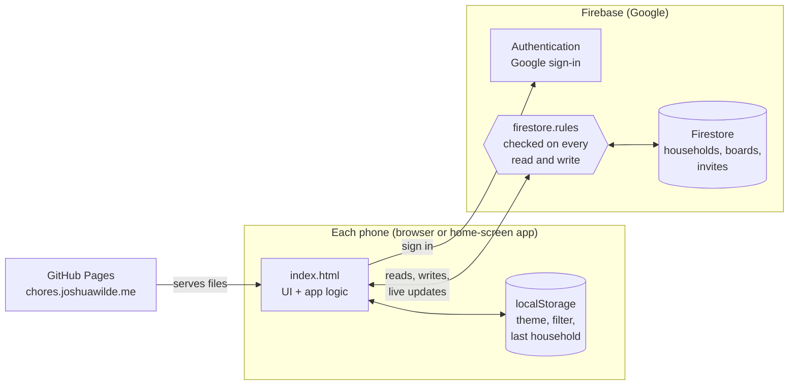
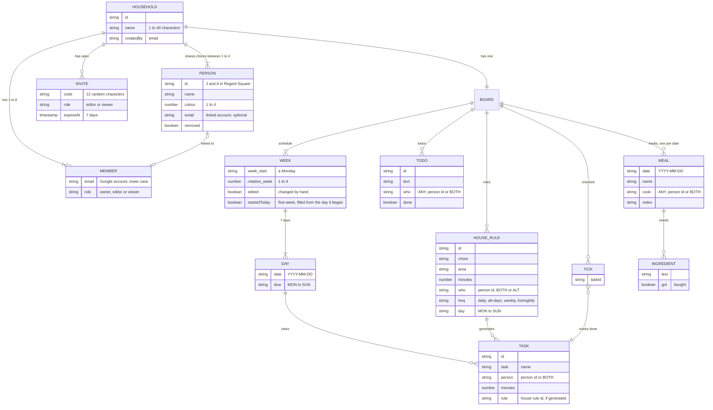
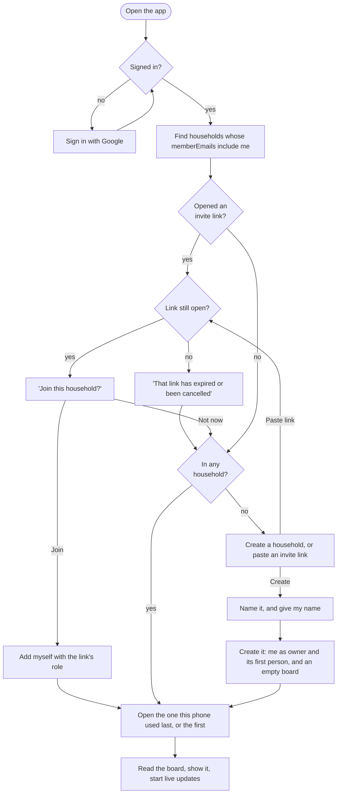

# How The Board works

The Board is a household app for chores, meals and to-dos, used mainly on iPhones.
This document explains how the project is put together, the things it stores
(entities), how they relate, and how data moves between the phones and Firebase.

- **Live site:** https://chores.joshuawilde.me (GitHub Pages, from `main`)
- **Backend:** Firebase project `jamritchoresapp` (Google sign-in and Firestore)
- **Setup steps** (creating the Firebase project, publishing rules): see the [README](../README.md)

---

## 1. The big picture

There is no build step and no server code. The whole app is one HTML file that
GitHub Pages serves as-is. Each phone loads it, signs in with Google, and talks to
Firestore directly. `firestore.rules` decides on Google's servers who can read or
change what, so the rules are the real security.



Changes made on one phone reach the others within a second or so, through
Firestore's live listeners (`onSnapshot`).

---

## 2. What's in the repository

| File | What it is |
|---|---|
| `index.html` | The entire app: styles, page markup and all the JavaScript. |
| `firebase-config.js` | Which Firebase project to use. These values are safe to publish; access is controlled by the rules. Setting it to `null` runs the app with no Firebase, saving on that device only. |
| `firestore.rules` | Server-side security rules: who can read or write each document. Published by hand in the Firebase console (Firestore → Rules). |
| `manifest.webmanifest` | Lets the site be added to a home screen and open full-screen like an app. |
| `icons/` | Home-screen (`touch-*.png`) and browser-tab (`favicon-*.png`) icons, one per theme. |
| `CNAME` | Tells GitHub Pages to serve the site at `chores.joshuawilde.me`. |
| `README.md` | Firebase setup steps and a short summary of households. |
| `docs/ARCHITECTURE.md` | This document. |

### Inside `index.html`

The file is in four parts, top to bottom. Each section of code starts with a
comment like `/* ---------- meals ---------- */`, so searching for `----------`
jumps between them.

1. **`<style>`.** All the CSS: the base look, then one block per theme, then the
   "liquid glass" effects shared by every theme.
2. **Page markup.** The header (title, tabs, week navigation, balance bar), the
   views for Chores, Meals, To-do and House rules, the floating bottom dock, the
   Stats and People sheets, and the sign-in card.
3. **`<script type="module">`, the store.** Loads Firebase, handles sign-in and
   onboarding, finds the household, reads its board and returns a **store**
   object. Everything else talks to Firebase only through the store (section 6).
4. **`<script>`, the app.** The house rules and week generator, rendering, editing,
   meals, to-dos, stats, People, themes and settings.

---

## 3. Entities and how they relate

### People, and who things are for

Each household lists its **people**: the one to four people its chores are shared
between, each with a name and one of four colours. Owners set them up in **People**.
This is different from its **members**, the Google accounts that can open the
household. A person can be **linked** to a member's account, and that phone then
opens on that person's chores.

Chores, to-dos and meals say who they're for with a person's **id**, or one of these
special values:

| Value | Meaning | Used by |
|---|---|---|
| a person's id | that person | tasks, rules, to-dos, meals |
| `BOTH` | everyone together ("Both", or "Everyone" with three or more) | tasks, rules, to-dos, meals |
| `ALT` | take turns, one occurrence each, through everyone in order | house rules only (becomes a person's id in each week) |
| `ANY` | anyone | to-dos and meals |

Some details:
- **Regent Square's ids.** Its people have the ids `J` (Joshua) and `A` (Amrit),
  the codes its chores have used since before people could be configured. A
  household that hasn't saved its people yet gets those two by default.
- **New households.** A household created in the app starts with one person, its
  creator, linked to their account.
- **Removed people.** They stay in the list, marked `removed`, so chores already in
  the weeks keep their name.

### Entity diagram

This is the conceptual model. Some of these are separate Firestore documents and
some are fields nested inside one; section 4 shows exactly how they're stored.



**In words:**
- **Households.** A household has one to eight **members**, each a Google account
  with a role. One account can belong to several households, with a different role
  in each.
- **People.** A household shares its chores between one to four **people**. A
  person can be linked to one member; members don't have to be people (for
  example, someone with View only who's just looking).
- **The board.** Each household has exactly one **board**: its house rules,
  schedule, ticks, to-dos and meals.
- **Weeks and tasks.** The **schedule** is a list of **weeks**. Each week has
  seven **days**, and each day has **tasks**. Most tasks are generated from a
  **house rule**, and remember which one in `rule`. Tasks added by hand don't have
  a rule.
- **Ticks.** A **tick** marks a task as done. Ticks are stored separately from the
  schedule, by task id, so ticking never rewrites the whole week.
- **Meals.** There's one **meal** per date. The shopping list isn't stored: it's
  worked out from the ingredients of the week's meals.
- **Invites.** An **invite** is a link that lets someone join a household with a
  set role until it expires or an owner cancels it.

---

## 4. How it's stored in Firestore

```
households/{householdId}
│   name            "Regent Square"
│   members         { "someone@gmail.com": "owner", "other@gmail.com": "viewer" }
│   memberEmails    ["someone@gmail.com", "other@gmail.com"]   ← same emails, so the app can search by email
│   invites         { "<code>": { role, expiresAt } }          ← links still open
│   people          [{ id, name, colour, email?, removed? }]   ← who shares the chores (missing: Joshua and Amrit)
│   createdBy, createdAt, joinedWith
│
└── board/                          (one document per kind of data)
    ├── schedule    { json: "<the weeks, as JSON text>", updatedBy, updatedAt }
    ├── rules       { json: "<the house rules, as JSON text>", updatedBy, updatedAt }
    ├── checked     { ids:   { "<taskId>": true, … } }
    ├── todos       { items: { "<todoId>": { text, who, done, at, doneAt }, … } }
    └── meals       { days:  { "2026-10-14": { name, cook, ingredients: [{ text, got }], notes }, … } }

invites/{code}      { hid, name, role, createdBy, expiresAt }   ← readable by anyone who knows the code

board/*                          ← the board from before households, kept as a backup (see section 9)
```

Some notes on these choices:
- **Concurrent edits.** Ticks, to-dos and meals are maps with **one field per
  item**. The app updates just that field (for example `ids.<taskId>`), so two
  phones can tick, add or plan at the same moment without overwriting each other.
- **Whole-document saves.** The schedule and house rules are saved as a whole,
  stored as JSON text. They change rarely, and when they do the whole list changes
  together.
- **`memberEmails`.** This duplicates the keys of `members` because Firestore can
  search an array ("households where `memberEmails` contains my email") but not a
  map's keys. The rules insist the two always match.
- **The household id.** Regent Square's id is `home`, because it was made from the
  original board. Households created in the app get a random id.
- **Task ids.** These are stable, so ticks stay attached to the right task:
  - generated tasks: `g_<date>_<ruleId>`, for example `g_2026-10-14_r13`
  - tasks added by hand: `u_<random>`
  - tasks from the original spreadsheet: `s<number>`

---

## 5. How a week is built

The **house rules** are the template, and the **schedule** is what they produce.
`generateWeek()` turns the rules into a week's tasks:

| `freq` | Lands on | Extra fields |
|---|---|---|
| `daily` | every day | none |
| `alt-days` | every other day | `weeks`: 0 or 1, which day it starts on |
| `weekly` | one day a week | `day` |
| `fortnightly` | one day every other week | `day`; `weeks`: 0 means rotation weeks 1 and 3, 1 means weeks 2 and 4 |

**Rotation and turns:**
- **Rotation weeks.** These count from Monday **24 Aug 2026** (rotation week 1)
  and cycle 1 to 4.
- **Taking turns.** A rule with `who: 'ALT'` goes through the household's people in
  order, one each time it comes round, starting with `first`. With Joshua and
  Amrit that's simply alternating.
- **Same result on every phone.** The calculation only depends on the date and the
  people, so every phone produces exactly the same tasks with the same ids.

**Keeping the schedule topped up:**
- **Weeks ahead.** The schedule always reaches **4 weeks past the current one**.
  When a phone opens the app, or passes midnight with it open, it adds any missing
  weeks and saves them (`ensureWeeksAhead()`).
- **Changing a house rule, or adding or removing a person.** This rebuilds every
  **future** week that nobody has edited by hand (`regenerateFutureWeeks()`).
  Adding, editing or deleting a task in a week marks that week `edited: true`, so
  hand changes are never overwritten. Past weeks are never regenerated, and
  neither is this week, so its ticks stay as they are. The exception is a week
  that's still being set up, as in a new household: if it's empty, it fills in
  from today (marked `startedToday`). It keeps filling in as rules are added, until
  something in it is ticked or edited by hand. A person can't be removed while house
  rules are theirs alone; those rules need someone else first.
- **Where the weeks started.** Regent Square's early weeks came from the original
  spreadsheet (`SEED_WEEKS` in `index.html`). A household created in the app
  starts with no rules and no weeks, and its weeks are generated from the day it
  starts.

**Balance bar and stats.** These add up the minutes of each person's tasks: what
was planned and what has been ticked. `BOTH` tasks count towards both people.

---

## 6. The store: one interface, two backends

The app never calls Firebase directly. It uses a **store** object with the same
methods in both modes:

| | `cloudStore()` | `localStore()` |
|---|---|---|
| Used when | `firebase-config.js` has a config | the config is `null`, or Firebase couldn't be reached |
| Saves to | Firestore, under the chosen household | this device's `localStorage` |
| Live updates | yes, with `subscribe()` | no |

The store provides:
- **The loaded data:** `schedule`, `rules`, `checked`, `todos`, `meals`.
- **Board changes:** `saveSchedule`, `saveRules`, `setChecked`, `setTodo`,
  `setMeal`.
- **Live updates:** `subscribe(onChange)`. The app's `onRemoteChange()` applies
  changes from other phones and redraws.
- **Cloud only:**
  - `household` and `households`
  - `renameHousehold`, `setMember`, `setPeople`, `createHousehold`,
    `createInvite`, `cancelInvite`
  - `signOut`

Changes show on screen straight away and save in the background. The small note
under the list shows *Saving… / Synced / Couldn't save*.

---

## 7. Signing in and getting into a household



Some details of this flow:
- **Links opened before signing in.** An invite link looks like
  `chores.joshuawilde.me/?join=<code>`. The app saves the code before sign-in
  (which can leave the page), removes it from the address bar, and offers it once
  signed in.
- **Switching households.** The settings menu lists your other households under
  "Switch to". Switching saves the choice for this phone and reloads.
- **Removed while the app is open.** If an owner removes you, the app reloads and
  goes through this flow again.

---

## 8. Roles and security

| What | Owner | Can edit | View only |
|---|:-:|:-:|:-:|
| See the board (chores, meals, to-dos, house rules, stats) | ✓ | ✓ | ✓ |
| Tick, add, edit, delete; plan meals; to-dos; house rules | ✓ | ✓ | – |
| Rename the household | ✓ | – | – |
| Set who shares the chores (people, colours, linked accounts) | ✓ | – | – |
| Add, remove or change the role of members | ✓ | – | – |
| Create or cancel invite links | ✓ | – | – |
| Leave the household | ✓ (if another owner remains) | ✓ | ✓ |
| Create a household of their own | anyone signed in with Google | | |

### What `firestore.rules` enforces

The rules are checked by Google on every request, so a modified app can't get round
them.
- **Signing in.** You must be signed in with a verified Google account.
- **Households:**
  - Only members can read a household or its board.
  - Only owners and editors can write to the board.
  - Only owners can change the household: name, people, members, roles and
    invites.
  - A household always has 1 to 8 members, at least one owner, and only valid
    roles. `memberEmails` must match `members`.
  - A new household can only contain its creator, as owner.
- **Joining with an invite.** You can add only yourself, with exactly the role the
  invite gives, and only while the invite is still listed on the household and
  hasn't expired.
- **Invites.** Anyone signed in can read an invite whose code they know, but can't
  list invites. Only owners can create or delete them, and they last at most 8 days
  (the app uses 7).
- **Leaving.** Anyone can remove themselves, as long as an owner is left.

In the app, view-only members see no edit controls, and a safety net blocks any
edit action before it reaches Firestore. The rules would reject it anyway.

---

## 9. Before households

Until 14 Oct 2026 there was one shared board at `board/*`, which two accounts
listed in a `members` collection could use. When households arrived:
- **The move.** The first of those accounts to open the new version named the
  household. The app created `households/home` (Regent Square) and copied
  `board/*` into it. Other accounts were then added to it.
- **The old data.** `board/*` was left untouched as a backup. Nothing in the app or
  the rules opens it any more, so it's only visible in the Firebase console.
- **Retired.** The `members` collection, and the rules and app code that moved
  those accounts in, have since been removed. The rules still let you read your
  own `members/{email}` entry, because older versions of the app look for it when
  they open. That can go once every phone has updated.

---

## 10. The interface

- **Tabs.** **Chores** (the week), **Meals** and **To-do**. **House rules** opens
  from the bottom of the Chores list and counts as part of Chores.
- **Header.**
  - Tapping **The Board** opens settings: theme, household, People, switching,
    new household, account.
  - Tapping the week's dates or the balance bar opens **Stats** (week or month).
  - The header shrinks as you scroll.
- **Bottom dock.** A liquid-glass switcher for *Everyone* and each person, which
  filters the week and the to-do list. It's hidden in a one-person household.
  Beside it, today's date shows only today.
- **People sheet.** Who shares the chores, members and roles, invite links, add by
  email, rename and leave.
- **People's colours.** Four per theme: `--c1` and `--c2` are the theme's original
  Joshua and Amrit colours, and `--c3` and `--c4` are chosen to sit apart from them
  and from `--both`. Badges, pickers and the dock receive a person's colour as
  `--pc`.
- **Themes.** Light, Dark, Pink, Spotify, Hello Kitty, iOS, iOS Dark, Master Chief,
  Covenant and Cortana. Each is a block of CSS variables selected by
  `data-theme` on `<html>` (iOS Dark is `data-theme="ios"` plus `data-ios="dark"`).
  The browser-tab and home-screen icons follow the theme.
- **Liquid glass.** `createLiquid()` drives the springy "drop" in pill bars and
  pickers (`liquidPicker()` for the person and role pickers). Single buttons get a
  light that follows the pointer, set through the `--hx` / `--hy` CSS variables.
- **Midnight.** Phones keep the page open for days. `checkNewDay()` checks every
  30 seconds, and whenever the app comes back to the front, then moves "today"
  along and tops up the weeks.

### Saved on each phone only (`localStorage`)

| Key | What |
|---|---|
| `jamrit_theme` | chosen theme |
| `jamrit_filter` | Everyone, or which person, in the dock |
| `jamrit_today` | whether "today only" is on |
| `jamrit_household` | the household this phone opens |
| `jamrit_invite` | an invite code waiting for sign-in to finish |
| `jamrit_schedule`, `jamrit_checked`, `jamrit_rules`, `jamrit_todos`, `jamrit_meals` | the board itself, in device-only mode |

---

## 11. Working on it

- **Running it locally.** Serve the folder with any static web server and open it
  at `http://localhost:<port>`. `localhost` is allowed for Google sign-in by
  default. A change shows up on refresh, because there's nothing to build.
- **Trying things without touching real data.** Temporarily set
  `window.FIREBASE_CONFIG = null` in `firebase-config.js`, and don't commit that
  change. The app then runs in device-only mode with the sample weeks.
- **Changing the rules.** Edit `firestore.rules`, then paste it into Firebase
  console → Firestore → Rules and **Publish**. Pushing to GitHub doesn't deploy
  rules. Publish rules that the live app still works with *before* merging app
  changes that depend on them.
- **Shipping.** Merging to `main` publishes the site through GitHub Pages within a
  minute or two. On an iPhone, fully close and reopen the home-screen app to load
  the new version.

### Planned next

- **Tidying up.** In time, delete the old `board/*` backup and the `members` read
  rule.
- **The default rules.** `DEFAULT_RULES` and `SEED_WEEKS` are Regent Square's and
  refer to `J` and `A`. They're only used for Regent Square and the device-only
  mode, never for a new household.
